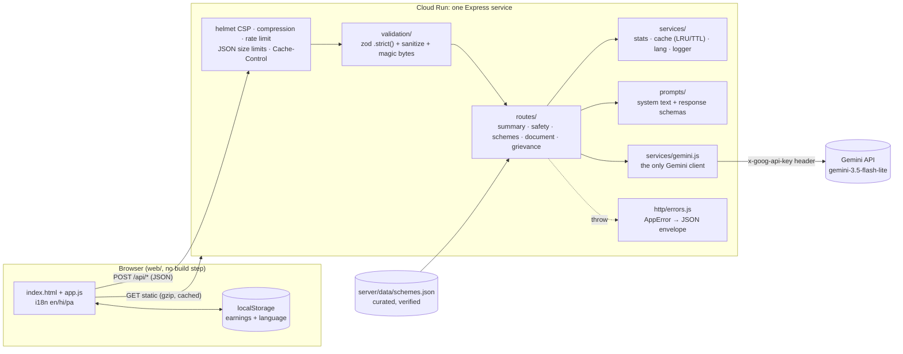

# Gig Worker Companion (Gig Saathi) — PromptWars Chandigarh

Multilingual (Hindi / Punjabi / English) helper for delivery and ride workers: earnings log with a Gemini weekly summary, safety tips, government-scheme Q&A grounded in curated data, document explainer (Gemini Vision) and a grievance drafter. All Gemini calls stay server-side; no login, no database.

## Local run

```bash
npm install
cp .env.example .env        # set GEMINI_API_KEY=<your key>; optional GEMINI_MODEL
npm start                   # http://localhost:8080/
npm test                    # vitest + supertest, Gemini mocked (no network)
npm run lint                # ESLint (flat config) + Prettier check
```

Do **not** commit `.env`. The API key is read from the environment only and never reaches frontend code.

## Architecture



Request flow: security middleware → zod validation (unknown fields rejected, free text cleaned) → route → code computes every number / loads curated data → one `gemini()` call with a per-route token cap and a JSON `responseSchema` → server-side post-checks (number filter, cited-id filter, ID masking, risk floor) → `{ ok, data }` envelope. Any thrown `AppError` (or unexpected error) is turned into `{ ok: false, error: { code, messageKey } }` by a single error middleware; stack traces are logged, never returned.

### Folder map

```
server/
  index.js              process entry (listen on $PORT)
  app.js                app factory: helmet/CSP, compression, rate limit, body limits, routes, static
  config.js             every tunable: model, per-route token caps, limits, cache TTL
  routes/               one file per feature; thin handlers (validate → compute → gemini → post-check)
  prompts/              system instructions + Gemini response schemas, one file per feature
  services/
    gemini.js           the ONLY Gemini client (language rule, data-only guard, retries, MAX_TOKENS escalation)
    cache.js            in-memory LRU + TTL cache
    stats.js            deterministic earnings math (Gemini never computes numbers)
    lang.js             hi/pa/en rules, script normalisation, wrong-language guard
    sanitize.js         control-char stripping, delimiter neutralising, question normalisation
    schemes-store.js    loads curated schemes.json
    logger.js           structured JSON logs for Cloud Logging
  validation/
    schemas.js          zod schemas for all 5 endpoints (.strict())
    validate.js         validation middleware
    image.js            magic-byte file type check
  http/
    envelope.js         { ok, data } / { ok:false, error } helpers
    errors.js           AppError, 404, central error handler
  data/schemes.json     curated government schemes (grounding source)
web/                    vanilla HTML/CSS/JS + i18n JSON (served statically)
test/                   vitest + supertest suites (Gemini mocked)
submission/             hackathon write-ups (GenAI map, tests, demo script)
```

## Security

- `helmet` with a strict CSP (`default-src 'self'`, `script-src 'self'`, no inline scripts/styles, `object-src 'none'`, `frame-ancestors 'none'`), HSTS, nosniff; `x-powered-by` off.
- `express-rate-limit`: 30 requests/min per IP on `/api/*` (standard `RateLimit` headers, 429 envelope).
- JSON body limit 32 KB (6 MB only on `/api/document`); images re-checked server-side by size (≤ 4 MB) and **magic bytes** (JPEG/PNG/WebP; declared MIME must match).
- zod `.strict()` on every body; free text is stripped of control/bidi characters and `<`/`>` are neutralised so user text cannot close prompt delimiters.
- Prompt-injection guard: user content is always wrapped in tags (`<facts>`, `<question>`, `<input>`, `<profile>`) and every system instruction ends with a data-only rule.
- API responses are `Cache-Control: no-store`; errors never include stack traces or internal messages. Document images are never stored or logged.
- `npm audit`: 0 vulnerabilities.

## Efficiency

- Per-route `maxOutputTokens` (`server/config.js`): summary/safety/schemes 2048, document/grievance 4096 (Gurmukhi/Devanagari headroom); one retry at 8192 only if Gemini reports `finishReason: MAX_TOKENS`.
- In-memory LRU/TTL cache: weekly summary (by stats + lang), safety (by situation + lang) and scheme answers (by lang + normalised question + profile). Repeat questions cost zero model calls.
- No model call when there is nothing to say (summary needs ≥ 2 logged days; empty schemes data → 503).
- Lean prompts: compact JSON, QA-only scheme metadata trimmed.
- Frontend: images downscaled in the browser to ≤ 1600 px JPEG before upload; submit buttons are single-flight (disabled + `aria-busy` while a request runs); schemes list is lazy-loaded when its tab opens.
- Static assets gzip-compressed, cached for 1 h; `index.html` is `no-cache` so deploys show up immediately. First load is `index.html` + `app.js` + `styles.css` + one i18n file: 54–61 KB raw, about 16 KB gzipped (whole `web/` folder 110 KB). No frameworks, no web fonts, no third-party requests, one deferred script.

## GenAI usage map

| Endpoint | Prompt file | Token cap | Purpose | Guardrails |
|---|---|---|---|---|
| `POST /api/summary` | `server/prompts/summary.js` | 2048 | Explain code-computed weekly stats | Numbers computed in `stats.js`; text mentioning unknown numbers is dropped; cached |
| `POST /api/safety` | `server/prompts/safety.js` | 2048 | Situational safety tips | Risk floor in code; phone numbers stripped; emergency numbers static; cached |
| `POST /api/schemes/ask` | `server/prompts/schemes.js` | 2048 | Eligibility Q&A grounded in `schemes.json` | Unknown cited ids dropped; `found` needs a known id; cached |
| `POST /api/document` | `server/prompts/document.js` | 4096 | Explain a document photo (Vision) | Magic bytes + size; long IDs masked; never stored |
| `POST /api/grievance` | `server/prompts/grievance.js` | 4096 | Formal complaint from validated facts + earnings evidence | Whitelisted facts only; signed with worker name; static complaint channels |

Model: `gemini-3.5-flash-lite` (override with `GEMINI_MODEL`), JSON `responseSchema` on every call, temperature ≤ 0.4, language rule on every call. No canned AI fallbacks: on failure the UI shows a localized error with Retry. Full map: [`submission/genai-map.md`](submission/genai-map.md).

## Tests

`npx vitest run` — validation, grounding, Gemini helper, security headers, rate limiting, body limits, magic bytes, injection guards, cache and token-cap behaviour. See [`submission/tests.md`](submission/tests.md).
